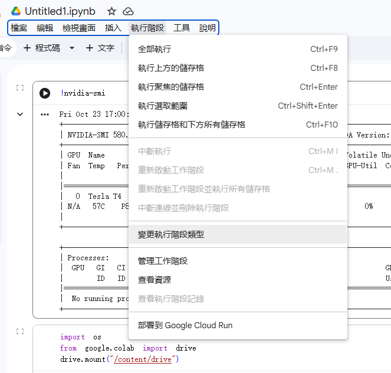
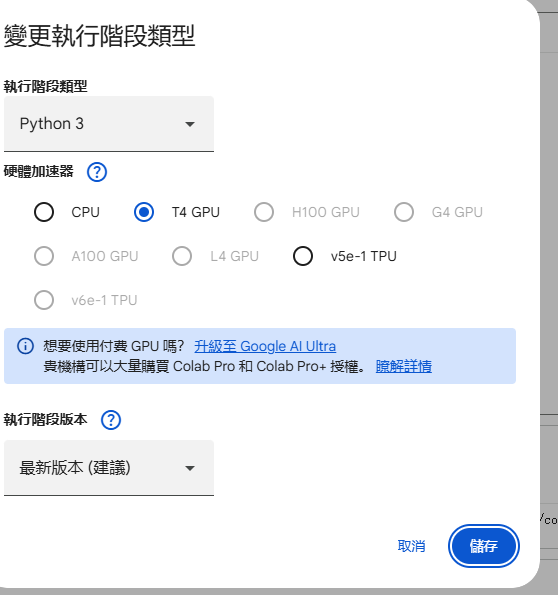
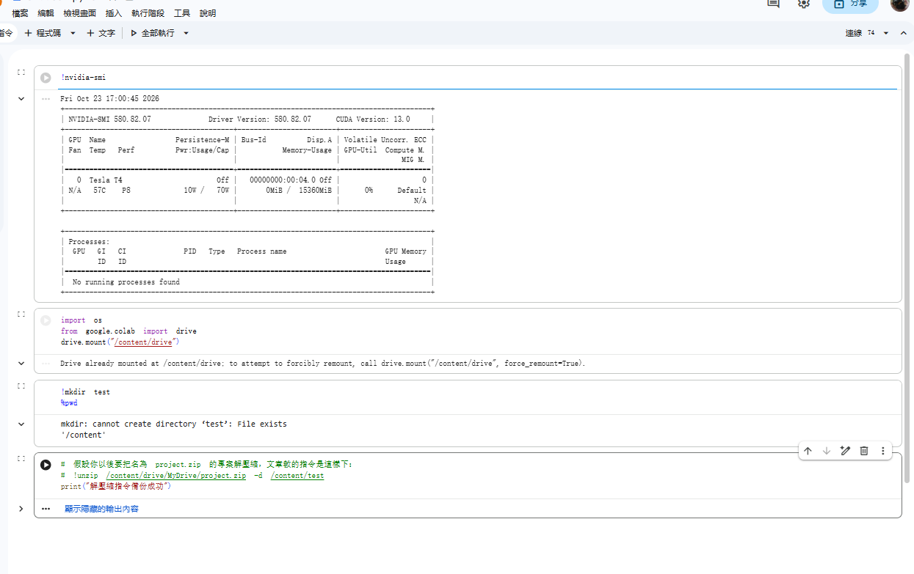

# 115 人工智慧 期中報告：如何在 Google Colab 礦機上執行 AI 示例流程

### 👥 組員名單
* 同學 劉威成（學號：11323005）
* 同學 湯景淳（學號：11325032）

### 📖 導讀文章題目
* **文章名稱**：Colab跑项目_colab运行自己的项目
* **文章網址**：https://csdn.net

---

## 🎯 實驗核心流程與實作截圖

根據指定文章的教學，我們成功在 Google Colab 上演練了操作外部 AI 專案與管理雲端環境的完整流程，實作結果如下：

### 1. 變更執行階段類型（啟用 GPU）
AI 訓練需要強大算力。我們點選 Colab 的「執行階段」選單，進入設定將硬體加速器切換為免費的 **T4 GPU**，確保後續 AI 範例能高速運算。

### 2. 執行環境配置與雲端硬碟掛載結果
成功配置環境後，我們在筆記本中依序執行 Linux 魔法命令與 Python 代碼：
* 透過 `!nvidia-smi` 成功抓取到伺服器端的 Tesla T4 顯示卡資訊。
* 透過 `drive.mount` 成功將 Google Drive 雲端硬碟掛載至運算環境（顯示 Drive already mounted）。
* 透過 `!mkdir test` 建立專案資料夾，並以 `%pwd` 確認當前工作路徑位於 `/content` 核心目錄。

---

## 💾 繳交程式檔案說明
* **AI_Colab_Workflow.ipynb**：本專案附帶的程式檔，已完整紀錄上述魔法命令與掛載雲端硬碟的執行流程，可直接點擊並在 Google Colab 環境中還原執行。
